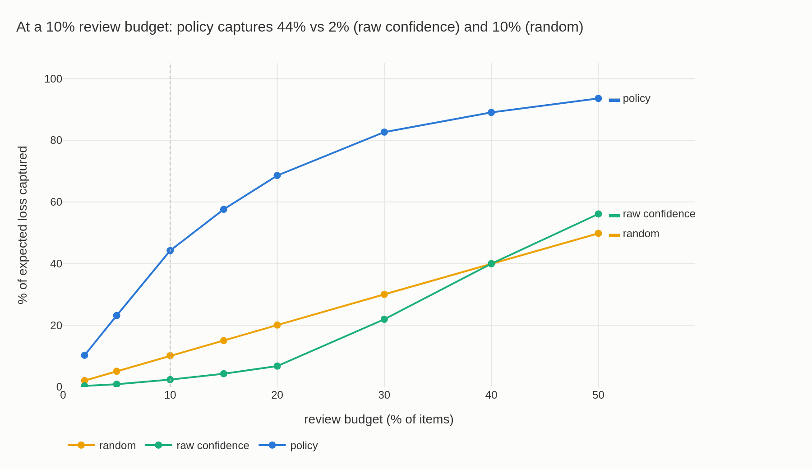

# triage

A local-first engine that decides *what humans should review* when review
capacity is limited. Takes AI-scored predictions + a declarative cost model +
a review budget, and outputs a deterministic, versioned routing policy that
maximizes expected risk captured per review.



At a 10% review budget on the seeded `overconfident` synthetic scenario
(seed 42): the policy captures **44%** of expected loss vs **2%** for raw
confidence and **10%** for random routing (`n_review = 1000` of 10 000
items). Numbers reproduced by `scripts/headline_chart.py --seed 42`.

## Why

AI pipelines produce more outputs than humans can review, and teams default
to routing by raw model confidence — but confidence is not a probability;
overconfident models are the norm, not the exception. Worse, all errors get
treated as equally costly, when a wrong critical field can cost orders of
magnitude more than a typo. The result: nobody has an honest answer to "what
risk are we accepting on the items we *don't* review?" `triage` calibrates
scores into real probabilities, applies declared per-segment costs, and
allocates a fixed review budget to maximize expected risk captured — instead
of guessing.

## How it works

```
scored predictions ──┐
                      ├─▶ calibrate ─▶ calibrator.json ─┐
golden (labeled) ─────┘                                 ├─▶ plan ─▶ policy.json ─▶ backtest (v1)
cost model (YAML) ───────────────────────────────────────┘
```

`calibrate` fits isotonic/Platt on a labeled golden set and picks the one
with lower ECE on holdout. `plan` uses the calibrator + declared per-segment
costs to greedily route items to review within budget, maximizing expected
loss captured. Every artifact embeds the sha256 of its inputs, the tool
version, and its config snapshot; `policy.json` carries a `policy_hash`
computed over semantic content only, so identical inputs always produce an
identical policy — determinism is the product, not a nice-to-have.

## Quickstart

```bash
uv sync

# Generate seeded synthetic data + costs.yaml (overconfident scenario)
uv run triage synth --scenario overconfident --seed 42 -o data/

# Fit a calibrator on the golden set
uv run triage calibrate --golden data/golden.parquet --seed 42 -o artifacts/calibrator.json

# Plan a routing policy against a review budget
uv run triage plan --batch data/batch.parquet --calibrator artifacts/calibrator.json \
                    --costs data/costs.yaml --budget 0.10 -o artifacts/policy.json

# Regenerate the headline chart above (same seed → identical numbers)
uv run python scripts/headline_chart.py --seed 42 -o docs/headline.png
```

Exit codes are a public API — CI gates depend on them, and their meanings
never change:

| code | meaning                          |
|------|-----------------------------------|
| 0    | OK                                 |
| 1    | input contract violation           |
| 2    | residual risk above declared gate  |
| 3    | calibration quality (ECE) below declared minimum |
| 4    | internal error                     |

## Design guarantees

- **Determinism**: same inputs → same `policy_hash`, always. Fixed, explicit
  seeds everywhere; stable sorts with `item_id` as the final tie-breaker;
  JSON artifacts written with sorted keys.
- **Self-describing artifacts**: every artifact embeds sha256 hashes of its
  inputs, the tool version, and the full config used to produce it — nothing
  needed to audit a result beyond the artifact itself.
- **Declared costs, not hardcoded logic**: `false_accept_cost` and
  `review_cost` per segment come from a YAML file the business owns; `segment`
  is an opaque string everywhere in the engine.
- **Local-first**: no network calls, no services, no databases, no telemetry.

## Status

MVP complete: input contract, calibration (isotonic/Platt + bootstrap ECE
CIs), cost model, greedy optimizer, synthetic generator, and this headline
chart (computed directly from `synth`/`calibration`/`optimizer` by
`scripts/headline_chart.py`, ahead of the full backtester).

Planned for v1: the `backtest` CLI command (policy vs. baselines replayed on
labeled history), a drift scenario in `synth`, the HTML report, and CI-ready
example gate workflows.

## License

MIT (placeholder — LICENSE file TBD).
