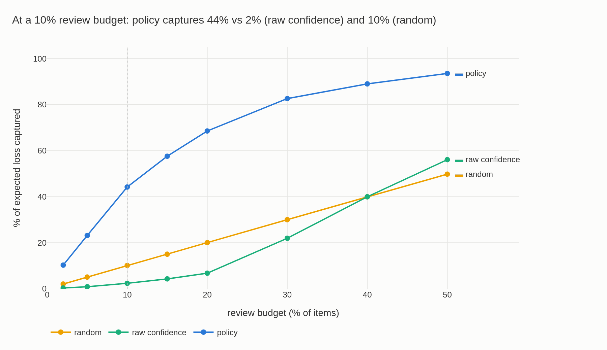

# triage

A local-first engine that decides *what humans should review* when review
capacity is limited. Takes AI-scored predictions + a declarative cost model +
a review budget, and outputs a deterministic, versioned routing policy that
maximizes expected risk captured per review.



At a 10% review budget on the seeded `overconfident` synthetic scenario
(seed 42): the policy captures **44%** of expected loss vs **2%** for raw
confidence and **10%** for random routing (`n_review = 1000` of 10 000
items). Numbers reproduced by `scripts/headline_chart.py --seed 42`.

## Why

AI pipelines produce more outputs than humans can review, and teams default
to routing by raw model confidence — but confidence is not a probability;
overconfident models are the norm, not the exception. Worse, all errors get
treated as equally costly, when a wrong critical field can cost orders of
magnitude more than a typo. The result: nobody has an honest answer to "what
risk are we accepting on the items we *don't* review?" `triage` calibrates
scores into real probabilities, applies declared per-segment costs, and
allocates a fixed review budget to maximize expected risk captured — instead
of guessing.

## How it works

```
scored predictions ──┐
                      ├─▶ calibrate ─▶ calibrator.json ─┐
golden (labeled) ─────┘                                 ├─▶ plan ─▶ policy.json ─▶ backtest ─▶ report
cost model (YAML) ───────────────────────────────────────┘
```

`calibrate` fits isotonic/Platt on a labeled golden set and picks the one
with lower ECE on holdout. `plan` uses the calibrator + declared per-segment
costs to greedily route items to review within budget, maximizing expected
loss captured (money budgets can opt into a fuller allocation, see
[Money budgets](#money-budgets-prefix-or-fill)). Every artifact embeds the sha256 of its inputs, the tool
version, and its config snapshot; `policy.json` carries a `policy_hash`
computed over semantic content only, so identical inputs always produce an
identical policy — determinism is the product, not a nice-to-have.

## Quickstart

```bash
uv sync

# Generate seeded synthetic data + costs.yaml (overconfident scenario)
uv run triage synth --scenario overconfident --seed 42 -o data/

# Fit a calibrator on the golden set
uv run triage calibrate --golden data/golden.parquet --seed 42 -o artifacts/calibrator.json

# Plan a routing policy against a review budget
uv run triage plan --batch data/batch.parquet --calibrator artifacts/calibrator.json \
                    --costs data/costs.yaml --budget 0.10 -o artifacts/policy.json

# Replay the policy on labeled history vs random and raw-confidence baselines.
# The calibrator is hash-verified against the policy — the chain is checked,
# not trusted. Realized residual loss is gated by gates.max_residual_risk
# (exit 2): plan can pass on expected numbers while backtest fails on drifted
# reality. Try --scenario drift above to see the alarm trip.
uv run triage backtest --policy artifacts/policy.json --calibrator artifacts/calibrator.json \
                    --history data/batch.parquet -o artifacts/backtest.json

# Render the self-contained HTML report: an at-a-glance status (On track /
# Needs attention / Gate failed) with headline numbers and CI-style checks
# first, then the evidence (policy vs baselines, coverage-vs-risk curves,
# per-segment plan vs actual, reliability diagram, gates) and the
# collapsed artifact hash chain
uv run triage report --from artifacts -o report.html

# Regenerate the headline chart above (same seed → identical numbers)
uv run python scripts/headline_chart.py --seed 42 -o docs/headline.png
```

Or run the whole chain above in one command (see
[One-command end-to-end run](#one-command-end-to-end-run)):

```bash
uv run triage run --scenario overconfident --seed 42 -o runs/overconfident
```

Exit codes are a public API — CI gates depend on them, and their meanings
never change:

| code | meaning                          |
|------|-----------------------------------|
| 0    | OK                                 |
| 1    | input contract violation           |
| 2    | residual risk above declared gate  |
| 3    | calibration quality (ECE) below declared minimum (point estimate by default, or CI upper bound with `ci_upper`) |
| 4    | internal error                     |
| 5    | replayed review capacity above `backtest --max-budget-overrun` |
| 6    | candidate policy significantly worse than the current one (`compare --fail-on-regression`) |

## One-command end-to-end run

`triage run` executes synth → calibrate → plan → backtest → report in one go.
It calls the same code as the individual commands, so the artifacts are
identical to the manual chain. `run --scenario well_calibrated --seed 7`
reproduces the committed `tests/golden/*.json` fixtures hash for hash. The
exit codes are also the same.

```bash
# Synthetic mode: one --seed drives synth, calibrate and the backtest baseline;
# the labeled synthetic batch doubles as the backtest history.
uv run triage run --scenario overconfident --seed 42 -o runs/overconfident
# [1/5] synth ... [5/5] report
# run: synth=ok calibrate=ok plan=ok backtest=ok report=ok -> runs/overconfident

# Own-data mode: your files (--history is optional; without it there is no backtest)
uv run triage run --golden golden.parquet --batch batch.parquet --costs costs.yaml \
                  --history history.parquet -o runs/mine
```

A run directory contains `costs.yaml` (the cost model actually used),
`artifacts/{calibrator,policy,backtest}.json`, `report.html`, and, in
synthetic mode, `data/`. With `--queue-format` it also contains the review
queue export (see [Exporting the review queue](#exporting-the-review-queue)).
Every command the run executed can be replayed by hand against these files.

**Overrides instead of hand-edited YAML.** `--budget`, `--budget-strategy`,
`--max-ece`, `--ece-gate-mode`, and `--max-residual-risk` patch the cost model. The
patched version is written to `<run>/costs.yaml`, so `plan` records it in
`policy.json` like any other costs file. `--max-budget-overrun` and
`--n-random-draws` pass through to `backtest`. Without overrides, the source
costs file is copied byte for byte. Reproducible gate scenarios, one command
each (seed 42):

| command | exits | why |
|---------|-------|-----|
| `run --scenario overconfident -o runs/a` | 0 | all gates pass |
| `run --scenario overconfident --ece-gate-mode ci_upper -o runs/b` | 3 | ECE upper bound 0.0820 > 0.05 (point 0.0463 passes) |
| `run --scenario drift --max-residual-risk 200000 -o runs/c` | 2 | plan passes (expected ≈ 142706), backtest fails (realized ≈ 336100) |
| `run --scenario overconfident --max-budget-overrun 1.1 -o runs/d` | 5 | 1183 replayed reviews vs 1000 budgeted (ratio 1.183) |
| `run --scenario drift --ece-gate-mode ci_upper --max-residual-risk 200000 -o runs/e` | 3 | several gates fail; the first one in stage order wins |

**Gate failures.** By default `run` keeps going after a failed gate, so every
artifact and the report are written and the report's Gates table shows the
failure. It then exits with the code of the first failed gate in stage order
(calibrate → plan → backtest). `--fail-fast` stops at the first failed gate
instead, exactly like chaining the commands with `set -e`. Contract
violations (exit 1) always stop immediately. The flags and input files are
validated before anything is written, using the same validation functions
as the individual commands. An option is therefore accepted or rejected
identically (same exit code, same message) whether you type the commands or
use `run`. `tests/cli/test_run.py` enforces this and compares `run`
against the manual chain stage by stage. Outputs of a previous run in the same
directory are then removed (only the files `run` writes), so a run never
mixes its artifacts with stale ones.

## Exporting the review queue

`policy.json` describes the plan: per-segment thresholds and totals. To feed
an actual human review workflow, `plan` can also export the exact list of
items it selected, in priority order, as CSV and/or Parquet:

```bash
uv run triage plan --batch data/batch.parquet --calibrator artifacts/calibrator.json \
                   --costs data/costs.yaml -o artifacts/policy.json \
                   --queue-csv artifacts/review_queue.csv --queue-parquet artifacts/review_queue.parquet
# n_review=1000/10000 captured=112699.9 residual=145224.7 policy_hash=d49d95195566 -> artifacts/policy.json queue=1000 rows -> artifacts/review_queue.json

# Same thing inside the one-command run (repeat the flag for both formats):
uv run triage run --scenario overconfident --seed 42 --queue-format csv --queue-format parquet -o runs/q
```

One row per selected item: `review_priority` (1 = review first), `item_id`,
`segment`, `p_error` (calibrated), `false_accept_cost`, `expected_loss`,
`review_cost`, `net_benefit` (the ranking key), plus `policy_hash` and
`batch_sha256` on every row, so a row copied into a review tool still points
at the plan and the batch it came from.

**Why not just apply the thresholds?** Because ties make them inexact. With
a step-function (isotonic) calibrator many items share the same `p_error`.
In the overconfident scenario at seed 42, 280 items sit exactly at the
seg_high threshold and the budget ran out 97 items into that tie. Applying
`p_error >= threshold` selects 1183 items; the optimizer selected 1000. The
queue is the optimizer's own selection, ties resolved by `item_id`.

**`review_queue.json`** is written next to the export. It records the
`policy_hash`, the input hashes, the row count, each file's sha256, a
format-independent `queue_hash`, the policy totals the queue reconciles
with, and the plan's gate outcome. That makes even an empty queue (a
header-only CSV) traceable. The queue reconciles with `policy.json`
*exactly*: row count, per-segment counts and thresholds, review spend and
expected captured loss all tie out bit for bit.

**Gates.** Like every artifact here, the queue is written even when a plan
gate fails, and `plan` still exits 2/3. The manifest records it:
`"gates": {"status": "failed", "failed": ["max_ece"]}`. **Check
`gates.status` (or the exit code) before handing a queue to reviewers.**

Notes:

- Exporting changes nothing else: `policy.json`, `policy_hash`,
  `backtest.json` and the report are byte-identical with and without it.
- Read the CSV with explicit string dtypes for `item_id`/`segment`; type
  inference would turn an id like `000123` into the number 123.
- If you open the CSV in a spreadsheet, ids or segments that begin with
  `=`, `+`, `-` or `@` can be interpreted as formulas. The export writes values
  verbatim (exactness comes first); sanitize at the spreadsheet boundary.
- `run` owns its queue files and removes stale ones; `plan` never deletes
  anything, so when you re-export a different set of formats into the same
  folder, trust the manifest's `files` list, not the folder contents.
- Contract: docs/interfaces.md §10.


## Comparing policies

Before adopting a new policy, ask two questions: does it improve on the
current one, and what does it do to the human review workload? `compare`
replays both policies on the same labeled history, each with its own
calibrator (hash-verified against the policy, like `backtest`), and prices
both with one cost basis.

```bash
uv run triage compare \
  --current-policy current/policy.json     --current-calibrator current/calibrator.json \
  --candidate-policy candidate/policy.json --candidate-calibrator candidate/calibrator.json \
  --history history.parquet -o comparison/
# verdict=trade_off (ci: trade_off) d_captured=+42500.0 d_reviews=+649 d_spend=+2596.0
#   d_total_cost=-39904.0 basis=policies comparison_hash=… -> comparison/comparison.json
uv run triage report --compare comparison/ -o comparison/comparison.html
```

`scripts/demo_compare.sh` runs three comparisons on the seeded
`overconfident` scenario: a budget change, a cost change, and an identical
policy.

**What you get.** Loss caught, loss left unreviewed, items reviewed and
review spend for both policies, with the change overall and per segment.
The review-queue change shows which items reviewers would keep, drop and
start seeing. The change in loss caught is exactly what the added items
catch minus what the dropped items caught. The verdict is `improvement`
(better on loss caught, reviews or spend, and worse on none), `regression`
(the reverse), `trade_off` (both) or `no_change`. It always comes with the
change in **total cost**, meaning loss left unreviewed plus review spend.
Total cost is the quantity the optimizer minimizes, so it tells you whether
a trade-off pays off.

**One cost basis, stated explicitly.** Two policies planned with different
costs report losses in different units, and the verdict can flip with the
units. On the `overconfident` scenario at seed 42, raising `seg_mid`'s
false-accept cost from 50 to 400 gives a candidate that looks better when
its own `backtest.json` is read next to the current one's:

| priced by | current caught | candidate caught | change in total cost | verdict |
|---|---|---|---|---|
| the current costs | 144,500 | 58,200 | +84,991 | significantly worse overall |
| the candidate's costs | 144,500 | 147,100 | −3,909 | improvement (on reviews and spend) |

So `compare` checks each history segment's costs under both policies
(exact entry, else `default`). If they disagree anywhere, it refuses to
compare (exit 1) and lists the conflicting segments. `--eval-costs
costs.yaml` supplies one explicit cost model for both policies; its budget
and gates are ignored. Budgets may always differ: they are policy choices,
not prices. The report says which basis was used, and flags a policy that
was planned under other costs.

**Is the difference real?** A paired bootstrap over the history items
(`--n-bootstrap 1000`, `--seed`, `--ci-level 0.95`) puts a confidence
interval on every change. A candidate calibrated with seed 43 instead of 42
reviews 3 fewer items for the same loss: a point-estimate `improvement`,
which the interval calls `inconclusive`. `--fail-on-regression` exits 6
only when the candidate is significantly worse: its total cost interval
lies entirely above zero, or it is worse on at least one of loss caught,
reviews and spend and better on none. `comparison.json` is written first, as
with every gate. Segments a policy never planned for are reported as "not
in plan" (it reviews nothing there), as opposed to "no threshold".

## Calibration gate: point estimate or CI upper bound

The ECE gate (exit 3) compares one statistic against the declared maximum.
By default that statistic is the holdout ECE point estimate (`ece_holdout`).
Opting into `ci_upper` compares the upper bound of the bootstrap CI
(`ece_ci[1]`, 95% by default) instead. A small holdout can then no longer pass
on a lucky point estimate, because the gate tightens automatically as the
evidence thins. Both modes use the same strict `>`, so a value exactly equal
to the threshold passes.

| mode              | checked value                      | calibrate flag               | cost YAML                   |
|-------------------|------------------------------------|------------------------------|-----------------------------|
| `point` (default) | `ece_holdout` (point estimate)     | (none) or `--ece-gate-mode point` | (none) or `gates.ece_gate_mode: point` |
| `ci_upper`        | `ece_ci[1]` (bootstrap CI upper bound) | `--ece-gate-mode ci_upper` | `gates.ece_gate_mode: ci_upper` |

Reproducible example, the overconfident scenario at seed 42: `ece_holdout =
0.0463`, `ece_ci = (0.0327, 0.0820)`. Against the emitted `max_ece: 0.05`,
the point estimate passes and the upper bound fails:

```bash
uv run triage synth --scenario overconfident --seed 42 -o data/

# point (default): 0.0463 <= 0.05 -> exit 0
uv run triage calibrate --golden data/golden.parquet --seed 42 \
                        --max-ece 0.05 -o gate-demo/calibrator.json; echo "exit=$?"

# ci_upper: 0.0820 > 0.05 -> exit 3 (calibrator.json is still written)
uv run triage calibrate --golden data/golden.parquet --seed 42 \
                        --max-ece 0.05 --ece-gate-mode ci_upper \
                        -o gate-demo/calibrator.json; echo "exit=$?"
# Error: Calibration quality gate failed (ece_gate_mode=ci_upper): ece_ci_upper=0.08199937079701163
#   (upper bound of the 95% bootstrap CI, calibrator.ece_ci[1]) exceeds max_ece=0.05;
#   ece_holdout=0.04631680609317865, ece_ci=(0.0327038775147435, 0.08199937079701163)
# exit=3

# Same gate declared in the cost YAML: plan writes policy.json, then exits 3
uv run python -c "import yaml; c = yaml.safe_load(open('data/costs.yaml')); \
c['gates']['ece_gate_mode'] = 'ci_upper'; yaml.safe_dump(c, open('ci_upper.yaml', 'w'))"
uv run triage plan --batch data/batch.parquet --calibrator gate-demo/calibrator.json \
                   --costs ci_upper.yaml -o gate-demo/policy.json; echo "exit=$?"
# exit=3

# The report's Gates table names the checked value and the threshold:
#   gate    | checked value                                          | threshold | value  | verdict
#   max_ece | calibrator.ece_ci[1] (upper bound of 95% bootstrap CI; | 0.0500    | 0.0820 | FAIL
#           |   ece_gate_mode=ci_upper)                              |           |        |
uv run triage report --from gate-demo -o gate-demo/report.html
```

Notes:

- `ci_upper` requires a threshold (`--max-ece` or `gates.max_ece`). A mode
  without one, an unknown mode, or a threshold outside `(0, 1]` (including
  NaN) is a contract violation (exit 1), rejected before anything is written.
- `ci_upper` is much stricter on small golden sets. All three synthetic
  scenarios fail it at 0.05 (upper bounds 0.074–0.082 at seeds 7 and 42)
  while passing the point gate. That is the point of the mode, but pick a
  threshold your golden-set size can actually support.
- The plan-time mode is persisted in `policy.json` as
  `config_snapshot.gates.ece_gate_mode` only when it is not the default.
  Default-mode policies, including every existing artifact, are byte-identical
  and keep their `policy_hash`, and an absent key means `point`. The
  `calibrate` flag is not stored in `calibrator.json`. Gate options never
  change the calibrator's content hash.

## Money budgets: prefix or fill

With a `money` budget, review costs differ by segment. The default
allocation (`prefix`) walks the ranking by net benefit (expected loss minus
review cost) and stops at the first item that does not fit. Budget can be
left unused even though cheaper items with positive net benefit would fit.
The opt-in `fill` strategy considers those items. It keeps the better of two
deterministic greedy allocations, both of which skip items that do not fit
and keep going:

- `net_benefit`: the default ranking.
- `net_benefit_per_cost`: ranked by net benefit per unit of review cost.

The winner is the one with the larger total expected net benefit (exact tie:
`net_benefit`). Guarantees: never worse than `prefix` on that objective, at
least half of the optimum, per-segment thresholds still exact, no
randomness.

### How to run it

1. **Use a money budget.** `fill` only applies to `budget.type: money`.
2. **Turn it on**, in whichever place suits you:

   ```yaml
   # in the cost YAML
   budget:
     type: money
     value: 4000
     strategy: fill      # omit (or `prefix`) for the default
   ```

   ```bash
   # per plan, without editing the YAML (overrides budget.strategy)
   uv run triage plan --batch batch.parquet --calibrator calibrator.json \
                      --costs money.yaml --budget-strategy fill -o policy.json

   # the whole chain in own-data mode (`run --scenario` uses the synthetic
   # fraction budget, so it rejects fill)
   uv run triage run --golden golden.parquet --batch batch.parquet --costs money.yaml \
                     --history history.parquet --budget-strategy fill -o runs/fill
   ```

   `--budget-strategy prefix` switches a YAML `fill` back to the default.
3. **Check what was used.** The `plan` summary line ends with
   `budget_strategy=fill selected_candidate=<name>`. `policy.json` records
   `budget.strategy` and `allocation.selected_candidate`, and the report's
   "Items reviewed" tile names both.
4. **Compare with the default.** Plan once with each strategy and backtest
   both policies on labeled history. `fill` optimizes expected values; the
   backtest shows how much of the gain is realized.

To check the whole feature in one go (static checks, its tests, the demo
below with its numbers verified, and the documented rejections), run
`bash scripts/test_fill_strategy.sh`. It rebuilds `demo/fill-strategy/`
from scratch each time, so repeated runs print identical output.

Reproducible example: the overconfident scenario at seed 42, with review
costs widened to 45 / 3 / 1 and a money budget of 1,000 cost units:

```bash
uv run triage synth --scenario overconfident --seed 42 -o data/
uv run triage calibrate --golden data/golden.parquet --seed 42 -o fill-demo/calibrator.json
uv run python -c "import yaml; c = yaml.safe_load(open('data/costs.yaml')); \
c['budget'] = {'type': 'money', 'value': 1000}; \
[c['segments'][s].update(review_cost=r) for s, r in \
 [('seg_high', 45.0), ('seg_mid', 3.0), ('seg_low', 1.0), ('default', 3.0)]]; \
yaml.safe_dump(c, open('money.yaml', 'w'))"

# prefix (default): stops after 22 seg_high items (990 spent); the next one does not fit
uv run triage plan --batch data/batch.parquet --calibrator fill-demo/calibrator.json \
                   --costs money.yaml -o fill-demo/policy.json
# n_review=22/10000 captured=3527.3 residual=254397.3 policy_hash=...

# fill: the per-cost ranking wins and spends the whole budget on seg_mid/seg_low
uv run triage plan --batch data/batch.parquet --calibrator fill-demo/calibrator.json \
                   --costs money.yaml --budget-strategy fill -o fill-demo/policy.json
# n_review=630/10000 captured=7587.2 residual=250337.4 budget_strategy=fill
#   selected_candidate=net_benefit_per_cost policy_hash=...
```

Notes:

- `fill` requires `budget.type: money`. With fraction or count budgets
  every review costs one unit and greedy is already optimal, so `fill`
  elsewhere is a contract violation (exit 1), rejected before anything is
  written.
- The objective is net benefit, not captured loss. `fill` can capture less
  expected loss than `prefix`, so a plan that passes
  `gates.max_residual_risk` under `prefix` can fail it under `fill`
  (exit 2). `fill` also spends nearly the whole budget, which leaves less
  room for threshold ties before `--max-budget-overrun` trips.
- The gain is in expected value. In the example above the backtest realizes
  7,220 captured loss vs 7,000 for `prefix`; calibration quality decides how
  much of the expected gain is real. See docs/risk-register.md R6.
- A `fill` policy records `budget.strategy` and
  `allocation.selected_candidate` in `policy.json`, and the report's budget
  label names both. `prefix` policies omit these keys, so every existing
  artifact is byte-identical and keeps its `policy_hash`.

## Design guarantees

- **Determinism**: same inputs → same `policy_hash`, always. Fixed, explicit
  seeds everywhere; stable sorts with `item_id` as the final tie-breaker;
  JSON artifacts written with sorted keys.
- **Self-describing artifacts**: every artifact embeds sha256 hashes of its
  inputs, the tool version, and the full config used to produce it — nothing
  needed to audit a result beyond the artifact itself.
- **Exact review queue**: the optional CSV/Parquet export is the optimizer's
  own selection (not a threshold replay), hash-linked to its policy and
  batch, and it reconciles with `policy.json` to the last bit.
- **Declared costs, not hardcoded logic**: `false_accept_cost` and
  `review_cost` per segment come from a YAML file the business owns; `segment`
  is an opaque string everywhere in the engine.
- **Local-first**: no network calls, no services, no databases, no telemetry.

## Status

v1 complete: everything in the MVP (input contract, calibration with
bootstrap ECE CIs, cost model, greedy optimizer, synthetic generator) plus
the `backtest` command (policy vs. random and raw-confidence baselines
replayed on labeled history, with capacity-sweep coverage-vs-risk curves
embedded in the artifact), a `drift` scenario whose stale policy the
backtester provably exposes (realized residual ≈ 2.4× expected at seed 42),
the self-contained HTML `report`, and a CI workflow
(`.github/workflows/ci.yml`) that runs the exit-code gates for real.

Since v1: an opt-in `fill` allocation for money budgets
([Money budgets](#money-budgets-prefix-or-fill)).


v1.x adds policy comparison: `compare` + `report --compare` (see
[Comparing policies](#comparing-policies); contract in docs/interfaces.md
§14), with a paired-bootstrap CI and an opt-in regression gate (exit 6).

Possible v2 (not started, see GOAL.md): grouped/knapsack routing for
document-level review.

## License

[MIT License](LICENSE).
